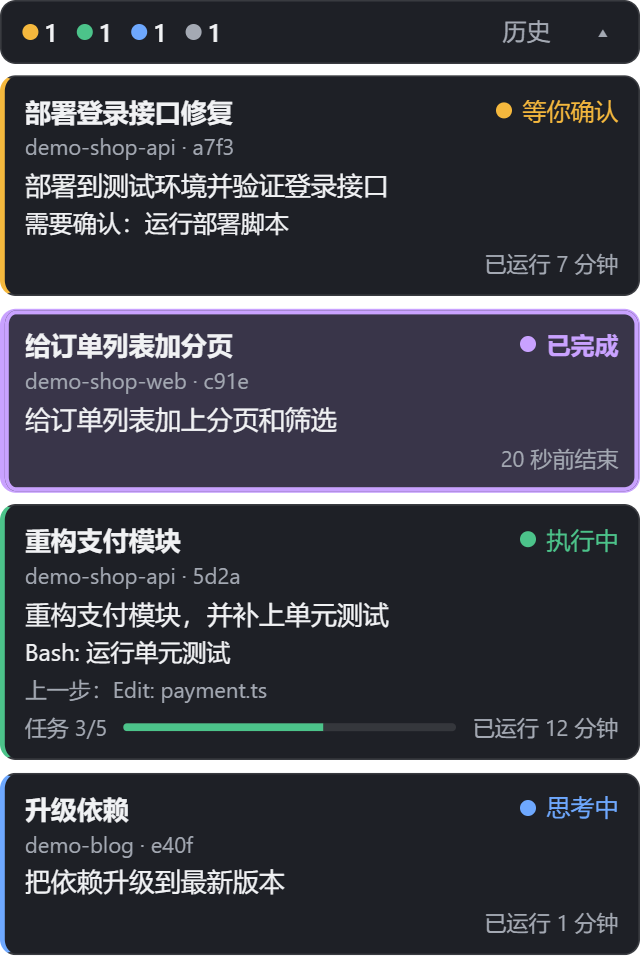
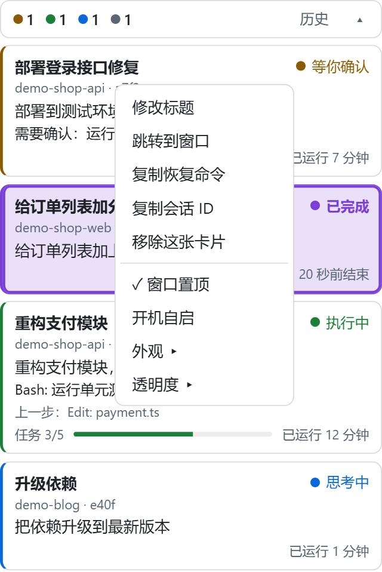
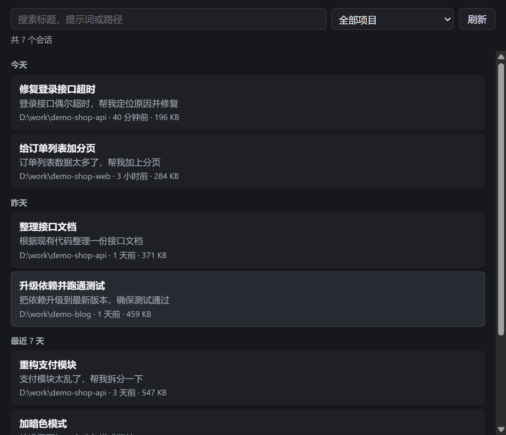

# claude-session-cards

用置顶小卡片查看所有 Claude Code 会话的状态：思考中、执行中、等你确认、已完成、出错。还能看今日和本周的用量、套餐限额，一键新开会话或恢复历史会话。状态来自 Claude Code hooks，不依赖其他工具。

<table>
  <tr>
    <td width="38%" align="center"></td>
    <td width="38%" align="center"></td>
  </tr>
  <tr>
    <td align="center">用量、限额和各会话的状态一目了然，完成时会提示</td>
    <td align="center">支持深浅主题，右键修改标题、切换置顶、调整大小</td>
  </tr>
  <tr>
    <td colspan="2" align="center"></td>
  </tr>
  <tr>
    <td colspan="2" align="center">搜索历史会话，点击在新标签页恢复</td>
  </tr>
</table>

截图中的项目和对话均为示例数据。

## 安装

需要 Node.js 22.12 或更高版本，以及较新的 Claude Code（已在 2.1.318 上使用）。

```sh
npm install -g claude-session-cards
claude-session-cards install   # 把 hook 和状态栏合并进 ~/.claude/settings.json，原文件会备份
claude-session-cards start     # 首次启动会下载 Electron
```

以后升级重新运行第一条命令即可。

已经打开的 Claude Code 会话需要重启，或打开一次 `/hooks` 才会加载 hook。

`install` 配置的状态栏会显示模型和套餐限额，并替换 Claude Code 底部原来的提示信息。如果你已经有自己的状态栏，不会被覆盖，这时只是读不到套餐限额。

## 命令

| 命令 | 作用 |
|---|---|
| `start` | 启动置顶卡片窗口，同时提供网页 `http://127.0.0.1:47831/` |
| `start --web` | 不开窗口，只提供网页 |
| `stop` / `status` | 退出 / 查看状态 |
| `install --dsh-pet` | 额外联动 DeepSeek Harness 的 dsh-pet 桌宠 |
| `uninstall [--purge]` | 移除 hook、状态栏和开机自启；`--purge` 同时删除本地数据 |

Electron 下载慢或失败时，可以设置 `ELECTRON_MIRROR` 后重试，或者用 `start --web`。

## 卡片操作

- 拖动顶部状态条移动位置，点箭头收起。
- 一轮结束或出错时卡片会闪烁提示，单击卡片确认后恢复；收起时状态条也会提示。
- 双击卡片跳转到对应的终端窗口，Windows Terminal 会同时切到对应标签页。窗口已经关闭时，会在新标签页恢复这个会话；还在运行却找不到窗口时只提示，不会开第二个。其他平台暂不支持，改为复制恢复命令。
- 卡片显示最后实际使用的模型和会话标题，可以右键“修改标题”，回车保存，Esc 取消。改过的标题会用 Claude Code 的 `/rename` 同步到会话（不调用模型）；会话开着时先只显示在卡片和历史窗口，等会话关闭后再同步，避免两个进程同时写记录。正在运行的终端标签名不会变。已同步的标题在 Claude Code 里用 `/rename` 再改。
- 右键卡片可以复制恢复命令或会话 ID、移除卡片，以及切换窗口置顶。
- 右键卡片或状态条可以切换外观（跟随系统、深色、浅色）、卡片透明度和整体大小（小、标准、大）。
- 点状态条上的 ＋ 新开会话：从最近用过的目录里选一个，或选择其他目录，会在新的 Windows Terminal 标签页启动 Claude Code。目前只支持 Windows。
- 点状态条上的“历史”查看历史会话，可以按标题、提示词或路径搜索，按项目筛选。点击后在新的 Windows Terminal 标签页恢复；会话还开着时改为切到它的窗口，其他平台改为复制恢复命令。Claude Code 默认只保留 30 天的记录（`cleanupPeriodDays`）。
- 状态条显示今日和本周的 Token 用量（周一起，只统计这台电脑，读取缓存不计入），以及 5 小时和 7 天的套餐限额；右键菜单的“用量显示”可以分别开关。
- 套餐限额来自 Claude Code 的状态栏数据，只有订阅用户才有，并且要有会话运行才会更新。`install` 会配置状态栏；如果你已经有自己的状态栏，不会被覆盖，这时只显示 Token 用量。
- 右键托盘图标可以隐藏、切换置顶、查看历史、开关开机自启或退出。
- 开机自启目前只支持 Windows，默认关闭，可以在托盘或右键菜单里开启。`uninstall` 会一并清除。
- 浏览器网页只读，点卡片是复制恢复命令。

## 平台支持

| 平台 | 置顶卡片 | 网页 |
|---|---|---|
| Windows | 已使用 | 已使用 |
| macOS | 未测试 | 未测试 |
| Linux | 未测试；不支持点击穿透，透明和置顶取决于桌面环境 | 未测试 |

## 隐私

- 本地保存提示词前 120 个字、项目路径、工具描述、会话标题、会话 ID、进程链和 transcript 路径（`~/.claude-session-cards/state.json`），24 小时无活动后清除。进程链和 transcript 路径只用于跳转窗口和读取标题，不会出现在网页接口里。你改过的标题单独保存在 `titles.json`，不会自动清除。
- 不上报命令原文，URL 不含查询串，不向任何外部服务发送数据。
- 用量只从记录里读取 Token 数字，不读对话内容；不会读取登录凭据。限额保存在本地的 `limits.json`。
- 同步标题时，工具会在会话目录里运行一次 `claude -p --resume <会话ID> "/rename ..."`，这个命令不调用模型。
- 历史会话直接读取 Claude Code 的记录文件，不另存副本，只能在本机查看。
- 默认只监听 127.0.0.1。

## 已知限制

- 进度条只在会话使用任务清单时显示，Claude Code 不提供真实的完成百分比。
- 用量是本地统计的结果，没有和官方数据核对，只作参考。
- ＋ 新开会话、双击跳转和开机自启目前只支持 Windows。
- 按 Esc 中断或进程被强杀时可能没有结束事件，卡片 30 分钟后才显示“可能已中断”。
- 不做定时重新置顶，以免打断全屏游戏和截图；卡片被盖住时，从托盘隐藏再显示即可。
